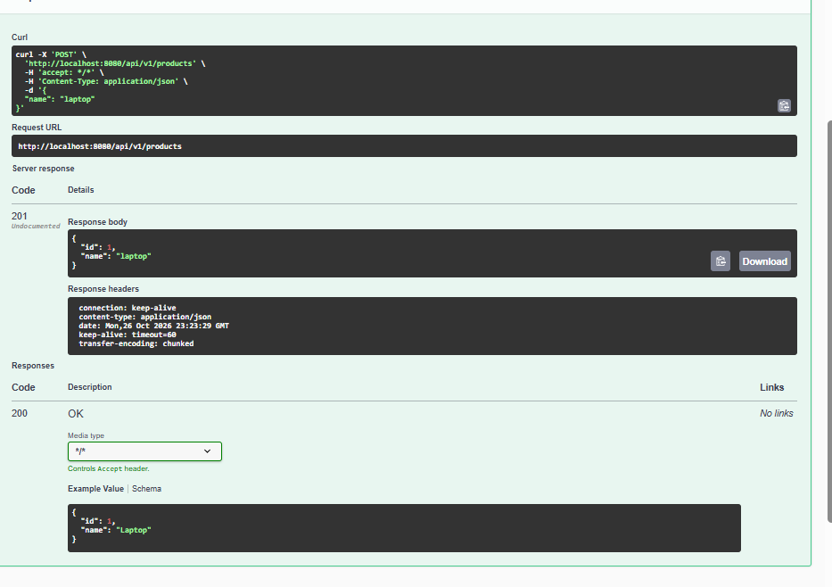
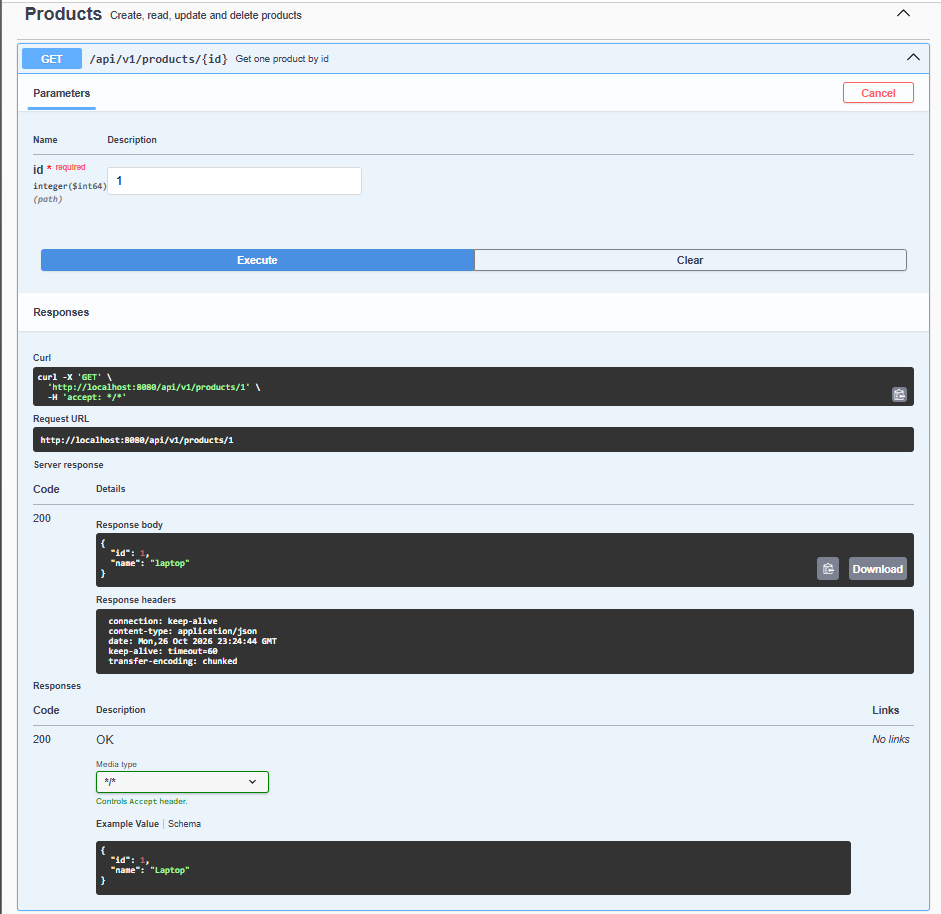
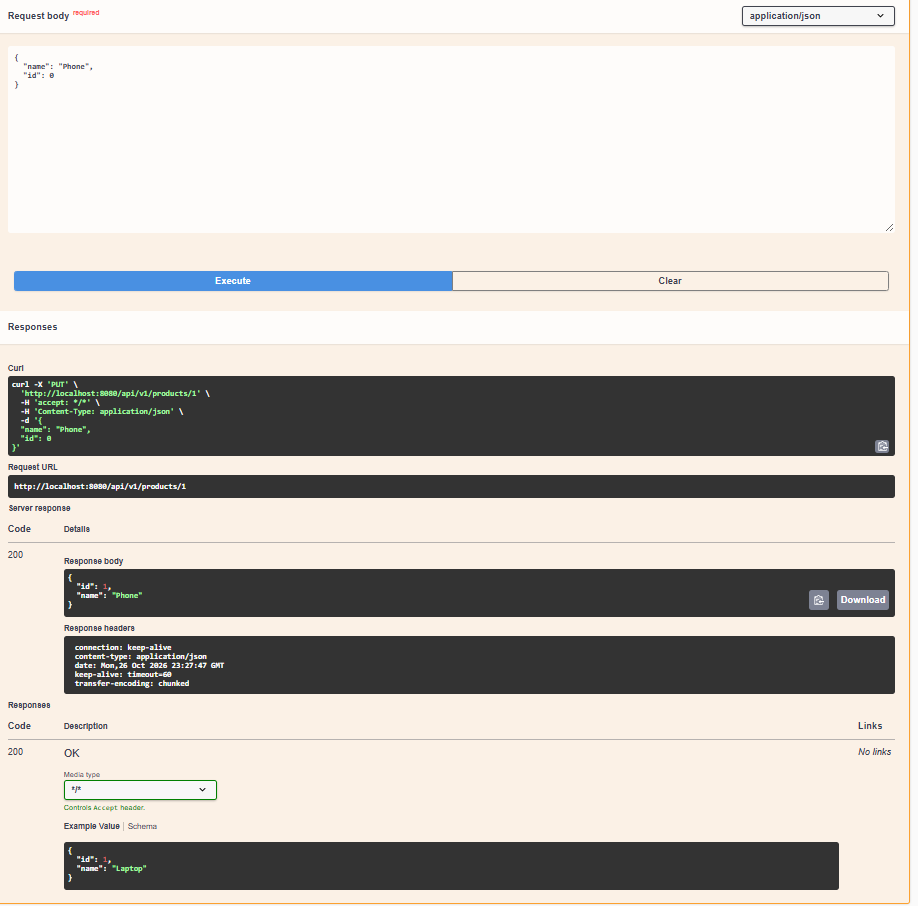
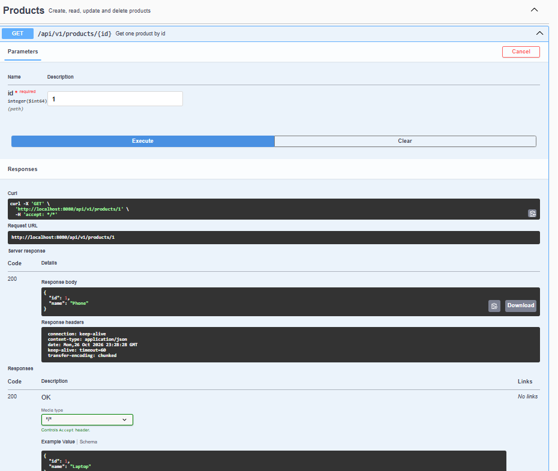
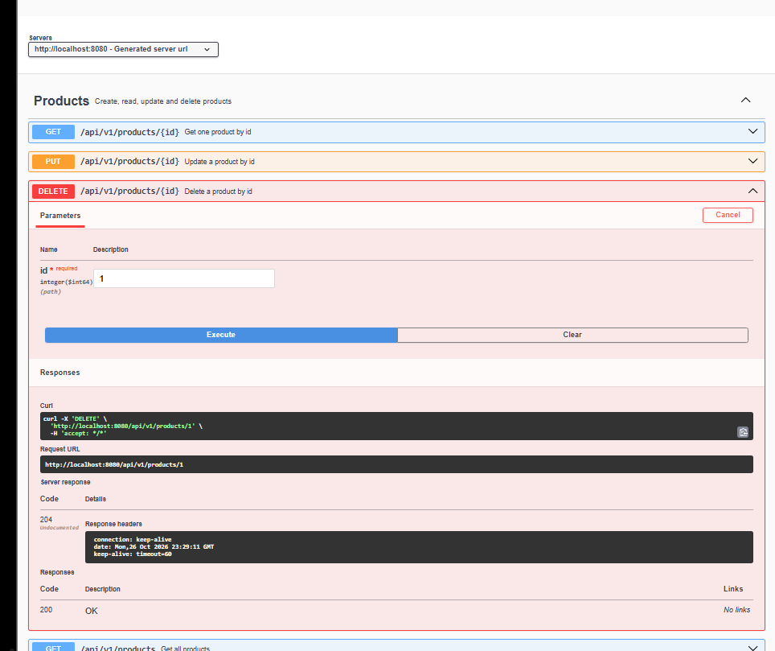
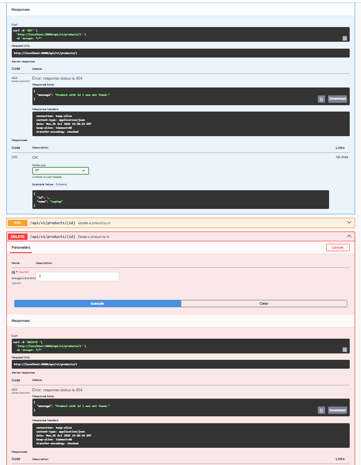
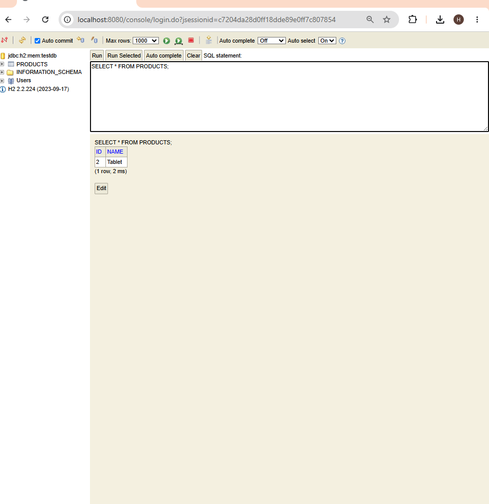
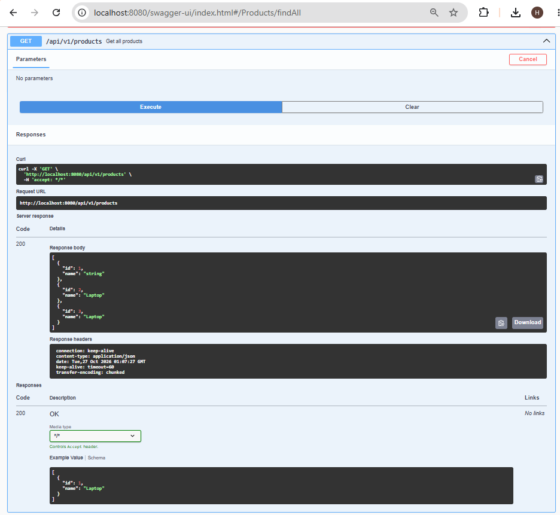

# Task 2 - Product REST API

This is my second Spring Boot project. It is a simple API for working with products.

I can add products, see them, change their names and delete them. The products are stored in an H2 database while the application is running.

## How to run

1. Open the project in IntelliJ IDEA.
2. Select Java 17.
3. Wait for Maven to download the dependencies.
4. Run `FirstRestApiApplication`.
5. Open Swagger:

http://localhost:8080/swagger-ui/index.html

## What I tested

I used Swagger to send requests to the application.

- **POST** - add a new product.
- **GET by ID** - find one product.
- **GET all** - show the list of products.
- **PUT** - change the name of a product.
- **DELETE** - delete a product.

For example, to add a laptop, I used POST and entered:

```json
{
  "name": "laptop"
}
```

After that, the application returned the product with an ID. I used this ID to find the product and change its name.

If I try to find, change or delete a product that does not exist, the application returns status 404.

## H2 database

I opened the H2 console at:

http://localhost:8080/console

To connect, I used:

- JDBC URL: `jdbc:h2:mem:testdb`
- User name: `sa`
- Password: empty

I used this query to check the products:

```sql
SELECT * FROM PRODUCTS;
```

The data disappears when I stop the application because the database is in memory.

The application returned the product with an ID.
## Screenshots

### 1. Create a product — POST

I created a product called laptop. The server returned status 201.



### 2. Get a product by ID — GET

I searched for the product with ID 1. The server returned the product and status 200.



### 3. Update a product — PUT

I changed the name of the product from laptop to Phone. The server returned status 200.



### 4. Check the updated product

I used GET again to check that the new name was saved.



### 5. Delete a product — DELETE

I deleted the product with ID 1. The server returned status 204.



### 6. Product not found

After deleting the product, I tried to find it again. The server returned status 404.



### 7. H2 database

I created another product called Tablet and checked the PRODUCTS table in the H2 console.



### Get all products — GET

I used GET to see all products. The server returned status 200.


